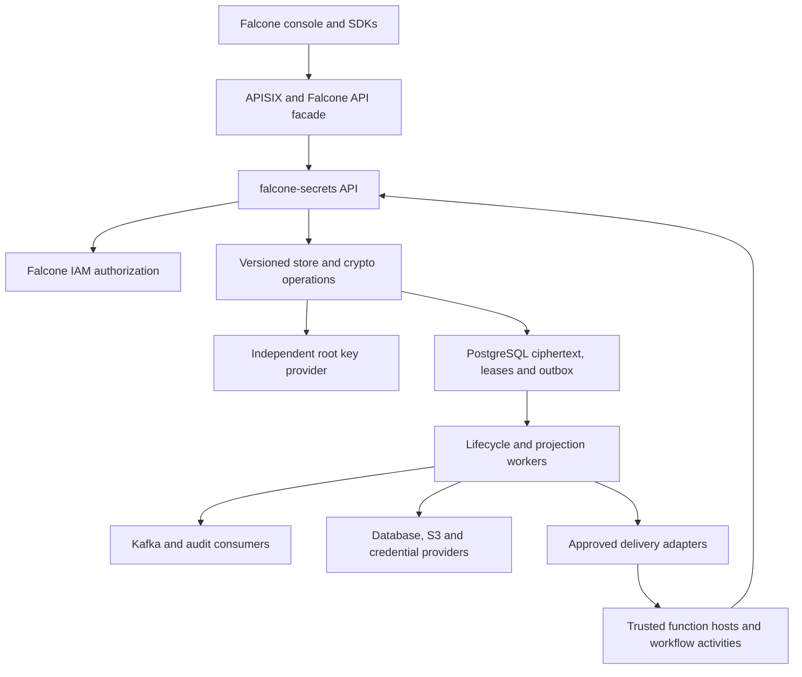
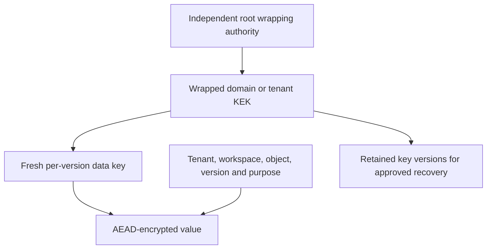
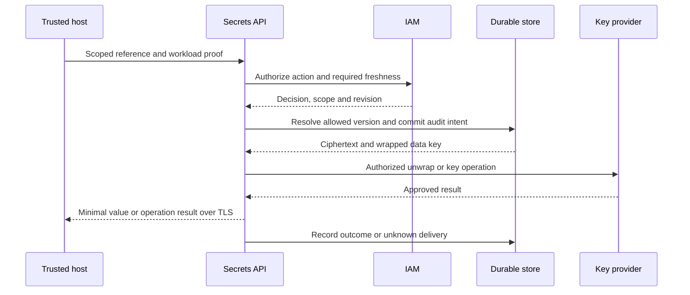

# Baseline architecture

Status: proposed for implementation qualification. This service replaces the OpenBao runtime dependency for the approved scope; it is not a renamed OpenBao deployment. The [ADR](decisions/0001-baseline.md) records alternatives.

## Components and trust boundaries

Begin with one modular codebase and separate API/crypto and lifecycle-worker deployment roles. Background workers persist operations rather than depending on Temporal or `falcone-workflow` for core secret renewal, unlock or revocation. Reference data and audit flow to existing Falcone systems; values never enter Kafka events.

## Recommended technology stack

| Component | Proposal | Rationale and qualification |
|---|---|---|
| Service | TypeScript on supported Node.js LTS | Aligns with current Falcone adapters and workflow/IAM design. Pin runtime and benchmark crypto/audit cost; memory zeroization limits are explicit |
| Crypto | Maintained Node/OpenSSL or qualified library primitives; authenticated encryption, reviewed signing schemes | No custom algorithms, XML crypto or nonce schemes; approved environment/FIPS requirements decide exact modules |
| Store | Existing PostgreSQL infrastructure, dedicated database/schema and least-privilege roles | Transactions for values/versions, leases, audit acceptance and outbox; encrypt payloads before database writes |
| Root custody | Pluggable external KMS/HSM wrapping/signing; approved operator-unlock profile if unavailable | Key authority must be recoverable independently of this store and IAM; availability is not assumed |
| Authorization | Falcone IAM decision contract, trusted local verification where qualified | Keep role/federation ownership in IAM; bootstrap has a narrowly independent path |
| Events | PostgreSQL outbox to existing Kafka-compatible bus | At-least-once events with revisions, replay and reconciliation; no plaintext on the bus |
| Workers | Database-claimed jobs with fencing tokens, deadlines and bounded retries | Avoid duplicate destructive rotations and distributed exactly-once promises |
| Delivery | Trusted SDK/host adapter or namespaced projector; existing ESO optional | No required new operator, CRD or daemon; preserve current approved adapters during migration |
| Caching | Bounded metadata/JWKS/policy caches; no default plaintext value cache | Authorization leases constrain freshness. Key handles/DEKs in memory have explicit lifetime and reseal behavior |
| Deployment | OCI images, ordinary namespaced workloads and Falcone packaging | Restricted OpenShift arbitrary UID, no cluster-admin or privileged runtime |
| Telemetry | Existing structured logs, OpenTelemetry and Prometheus conventions | No body capture, values or unrestricted metric labels; durable audit is separate from best-effort telemetry |

## Data and authority

| Entity | Authority | Consumer contract |
|---|---|---|
| Users, machines, memberships, roles, SAML/OIDC/LDAP/AD/SCIM | `falcone-iam` (Keycloak-era adapters during migration) | Secrets validates trusted actor and current scoped permission; it does not implement another IdP |
| Resource existence and workspace/environment ownership | Falcone control/resource services | Canonical scoped IDs, verified attributes and lifecycle events |
| Secret values/versions and metadata | `falcone-secrets` after explicit handoff | Immutable internal version; public metadata contract remains write-only and may hide version fields |
| Leases and rotation coordination | `falcone-secrets` | Tracks requested and applied provider/consumer outcomes; target systems enforce actual credentials |
| Credential validity, DB sessions, S3 keys, broker ACLs | Actual provider/backend | Adapter verifies issuance/revocation and reports uncertainty; store state alone cannot revoke a copied credential |
| Encryption root and recovery material | Approved independent custodians/provider | Protected handles or operator unlock, outside ciphertext storage |
| IAM signing intent and public issuer contract | IAM; key custody/allowed crypto operations in secrets/provider | Purpose-bound key use, qualified remote-signing or explicit protected export |
| Plans, quotas and accounting | Falcone quota services | Apply approved limits and emit usage; do not duplicate quota definitions |
| Consumer adoption | Authenticated registered workload, corroborated by provider/rollout checks | Separate delivery, loading, validation and backend revocation statuses |

Suggested tables: `secret_objects`, `secret_versions`, `key_envelopes`, `key_metadata`, `reference_bindings`, `consumer_registry`, `rotation_operations`, `rotation_consumers`, `leases`, `provider_operations`, `outbox`, `audit_acceptance`, `migration_mappings`, `tombstones`. Tenant/workspace keys and foreign keys must prevent cross-scope joins. RLS is defense in depth; privileged service access still needs explicit policy checks. Searchable names/descriptions and access metadata are sensitive even when ciphertext protects values.

## Encryption hierarchy

The root protects domain/tenant key-encryption keys; those protect fresh data-encryption keys for immutable secret versions. Direct root-provider wrapping of each data key is an alternative with different throughput/cost. The selected format authenticates scope, object/version, purpose and algorithm metadata. Generate cryptographic randomness through maintained libraries, never accept untrusted caller-controlled nonces. Keep nonce/key-use limits in the reviewed implementation profile.

Changing a KEK rewraps data keys. It does not change the secret value or external database password. Re-encrypting values with fresh data keys is a different operation; changing the accepted external credential is a third operation. Track them separately. Preserve old key versions while retained ciphertext/backups require them, and qualify compromise response before retirement.

## Typical secret resolution

The public console never follows this value-returning path. Trusted deployment/runtime consumers require a separate permission and workload binding. Where possible the host performs the downstream operation rather than giving tenant code the secret. An approved function that receives plaintext can copy or transmit it; secret management cannot reverse that fact.

Record required audit acceptance before release. If a connection drops after sending, delivery may be unknown; retries require current authorization and a new audit entry. Do not persist response bodies merely to implement idempotency. Value-bearing writes can retain an encrypted request/result association or keyed digest for a bounded deduplication window; never put plaintext in an idempotency table.

## Rotation and leases

Use a durable state machine: prepare new version/credential, activate at provider if necessary, deliver to registered consumers, verify reload/adoption, end grace, revoke old backend credential, reconcile. Current public active/grace/expired/revoked states remain compatibility projections of richer internal operations. Use fencing and compare-and-swap to prevent concurrent workers from completing obsolete rotations.

There is no transaction spanning PostgreSQL, an external database account change and Kubernetes rollout. Persist intent and operation IDs, safely retry supported actions, and mark ambiguous effects for reconciliation. ACKs prove what a consumer reports, not that an untrusted consumer erased old bytes. Grace expiry alone does not terminate an existing SQL connection or invalidate every S3 URL.

Dynamic leases bind an issued provider identity to principal, scope, workload/attempt, parent grant, TTL and maximum expiry. Renewal reauthorizes; revoke/renew races are serialized. During provider outage, report `revocation_pending` rather than claiming success. Prefer providers with independently enforced expiry, but still reconcile active sessions and orphan credentials.

## API compatibility strategy

Preserve current `/v1/functions/workspaces/.../secrets`, `/v1/secrets/inventory`, metadata and rotation contracts through the Falcone facade. Existing `vaultVersion`, `vaultMount` and `vaultRequestId` fields remain mapped compatibility names when required. New internal operations—resolve, key-use, lease issuance/renewal, consumer status and migration—receive explicit versioned schemas during implementation.

Only an inventoried, test-backed Vault-compatible subset may exist for ESO/direct consumers. An existing ESO webhook/custom-provider adapter is another option. No secret-reading API should be exposed through a metadata route simply to simplify compatibility. Response schemas, request-size limits, duplicate/conflict behavior and authorization precedence are acceptance criteria.
